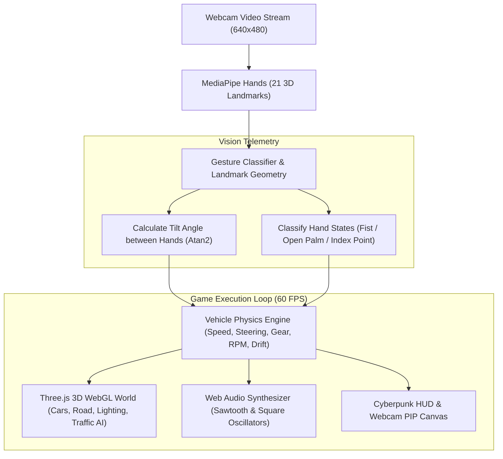

<p align="center">
  
</p>

<p align="center">
  <a href="https://colab.research.google.com/github/dipzz0/CargamezVision/blob/main/CargamezVision.ipynb" target="_blank"></a>
  
  
  
  
</p>

---

## ⚡ Overview

**CargamezVision** is an interactive, browser-based 3D highway racing game designed to run seamlessly directly inside **Google Colab**. 

It eliminates the need for physical steering wheels, gamepads, or keyboard controls by utilizing **Computer Vision AI** to track both of your hands in real-time via a standard webcam. By calculating the relative angle between both hands, the game dynamically renders a virtual glowing steering wheel on screen and translates natural hand gestures into high-speed driving mechanics—including acceleration, braking, nitro thrusts, drifting, honking, and headlight control.

---

## 🚀 Key Features

- **🖐️ Vision-Powered Virtual Steering:** Tracks 21 hand keypoints in real time using **Google MediaPipe Hands**. An intuitive virtual wheel automatically bridges between your two hands and steers your vehicle based on hand tilt.
- **🏎️ Three.js 3D Racing World:** Features an infinite procedural night highway, randomized city skyscrapers with emissive window lighting, roadside lampposts, stars, dynamic car lighting, and realistic traffic AI.
- **🔥 Reactive Particle & Visual Effects:** Dual high-intensity nitro exhaust flames, camera shake on impact, red damage flashes, and dynamic field-of-view (FOV) expansion during high-speed acceleration.
- **🔊 Fully Procedural Web Audio Engine:** Synthesizes realistic dual-oscillator engine revving with dynamic pitch tracking according to RPM and vehicle speed, dual-tone horn honks, tire skidding audio, and crash sounds—requiring zero external audio files.
- **📊 Cyberpunk Telemetry HUD:** Custom HTML5 canvas HUD featuring an analog speedometer dial (KM/H), gear display (1–5 + Reverse), RPM bar, health monitor, recharging nitro tank, and overtake counter.
- **☁️ Zero-Installation Colab Compatibility:** Self-contained within a single Google Colab cell using `IPython.display.HTML`. Can also be launched directly offline in any modern web browser via `index.html`.

---

## 🎮 Workflow & Architecture

The following diagram illustrates how video frames from your webcam are processed into game control telemetry and rendered in 3D:



---

## 🖐️ Hand Gesture Control System

Hold both hands up in front of your webcam inside the camera preview card at the bottom of the game.

| Gesture Combination | In-Game Action | Description |
| :--- | :---: | :--- |
| **Tilt both hands (like holding a wheel)** | 🔄 **Steering** | Tilt clockwise to turn right; tilt counter-clockwise to turn left. |
| **Both hands as FISTS (`✊ + ✊`)** | ⚡ **Accelerate (Gas)** | Clench both fists to press the gas pedal and accelerate up to 220+ km/h. |
| **Both hands OPEN PALMS (`✋ + ✋`)** | 🛑 **Brake / Reverse** | Open both palms to engage brakes. If stationary, holding open palms reverses the car. |
| **Left Fist + Right Index UP (`✊ + ☝️`)** | 🚀 **Nitro Thrust** | Unleashes nitro boost up to 300 km/h with orange exhaust flames. |
| **Left Index UP + Right Fist (`☝️ + ✊`)** | 🏁 **Handbrake / Drift** | Engages handbrake for sharp cornering and controlled highway drifts. |
| **Left Open Palm + Right Fist (`✋ + ✊`)** | 📢 **Horn** | Triggers an authentic dual-tone warning horn sound. |
| **Right Open Palm + Left Fist (Hold 0.7s)** | 💡 **Headlights ON/OFF** | Toggles 3D spotlights and headlights for night driving visibility. |
| **Both Fists (Hold 1.5s after crash)** | 🔁 **Quick Restart** | Automatically resets the car, traffic, and distance counter after a crash. |

### ⌨️ Keyboard Backup Controls
If you wish to test without a webcam, standard keyboard controls are also built in:

| Key | Function |
| :---: | :--- |
| `W` / `Up Arrow` | Accelerate (Gas) |
| `S` / `Down Arrow` | Brake / Reverse |
| `A` / `Left Arrow` | Steer Left |
| `D` / `Right Arrow` | Steer Right |
| `Space` | Handbrake |
| `Shift` | Nitro Boost |
| `H` | Horn |
| `L` | Toggle Headlights |
| `R` | Restart Game |

---

## 💻 How to Run in Google Colab

Running CargamezVision in Google Colab takes less than 30 seconds:

1. **Open the Notebook:**  
   Click the badge at the top or open [`CargamezVision.ipynb`](CargamezVision.ipynb) directly in [Google Colab](https://colab.research.google.com/github/dipzz0/CargamezVision/blob/main/CargamezVision.ipynb).

2. **Select Runtime:**  
   - Any standard Colab runtime works (CPU or T4 GPU).
   - Go to **Runtime** > **Change runtime type** > Select **T4 GPU** (optional, recommended for smooth 60 FPS).

3. **Execute the Code Cell:**  
   - Press `Ctrl + Enter` (or `Shift + Enter`) on the notebook cell.

4. **Grant Camera Permission:**  
   - A browser dialog will appear asking for webcam access. Click **"Allow"**.
   - *(Note: Ensure you are using Google Chrome or Chromium-based browsers for optimal MediaPipe WebAssembly performance).*

5. **Initialize Audio & Play:**  
   - **Click once anywhere on the game card** to satisfy browser autoplay policies and enable the synthesizer audio.
   - Position yourself approximately 2–3 feet from the camera with both hands visible, clench both fists, and drive!

---

## 🌐 Running Locally (Offline Webpage)

You do not even need Python or Jupyter installed to play locally:

1. Clone or download this repository:
   ```bash
   git clone https://github.com/dipzz0/CargamezVision.git
   cd CargamezVision
   ```
2. Double-click **`index.html`** to open it in **Google Chrome** or **Brave / Edge**.
3. Allow camera access and enjoy!

---

## 🛠️ Technology Stack

- **Computer Vision:** [Google MediaPipe Hands](https://developers.google.com/mediapipe/solutions/vision/hand_landmarker) (Client-side WebAssembly inference)
- **3D Graphics Engine:** [Three.js](https://threejs.org/) (WebGL rendering, materials, spotlights, fog, and shadow simulations)
- **Sound Design:** Web Audio API (real-time sawtooth and square wave oscillators with bandpass/lowpass biquad filters)
- **Front-End & UI:** HTML5 Canvas 2D (HUD overlay & PiP tracking camera) and CSS3 Flexbox
- **Platform:** Google Colab (`IPython.display.HTML`) & Modern Web Browsers

---

## 💡 Tips for Best Hand Tracking Performance

1. **Lighting:** Ensure your room has balanced lighting without harsh backlighting or glare directly behind you.
2. **Hand Visibility:** Keep both hands roughly at chest height within the camera's view frame.
3. **Background Contrast:** A neutral background without moving objects or other people improves gesture precision.
4. **Latency:** The lightweight MediaPipe model complexity (`modelComplexity: 0`) ensures consistent 60 FPS even on modest laptops.

---

## 📄 License

This project is open-source and distributed under the [MIT License](LICENSE).

---

<p align="center">
  <b>Developed with ❤️ by <a href="https://github.com/dipzz0">dipzz0</a></b><br>
  <i>Feel free to star ⭐ the repository if you enjoyed this project!</i>
</p>
